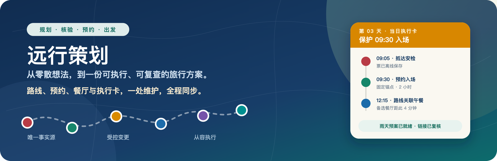
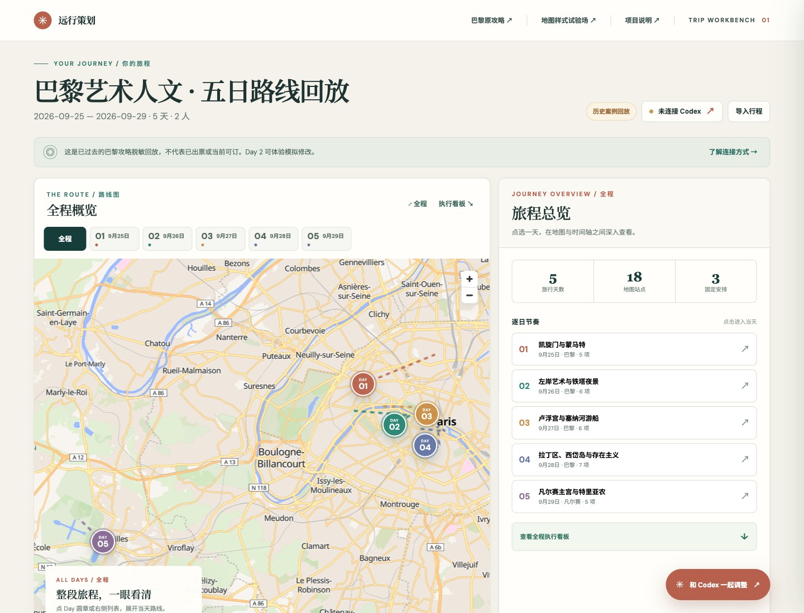
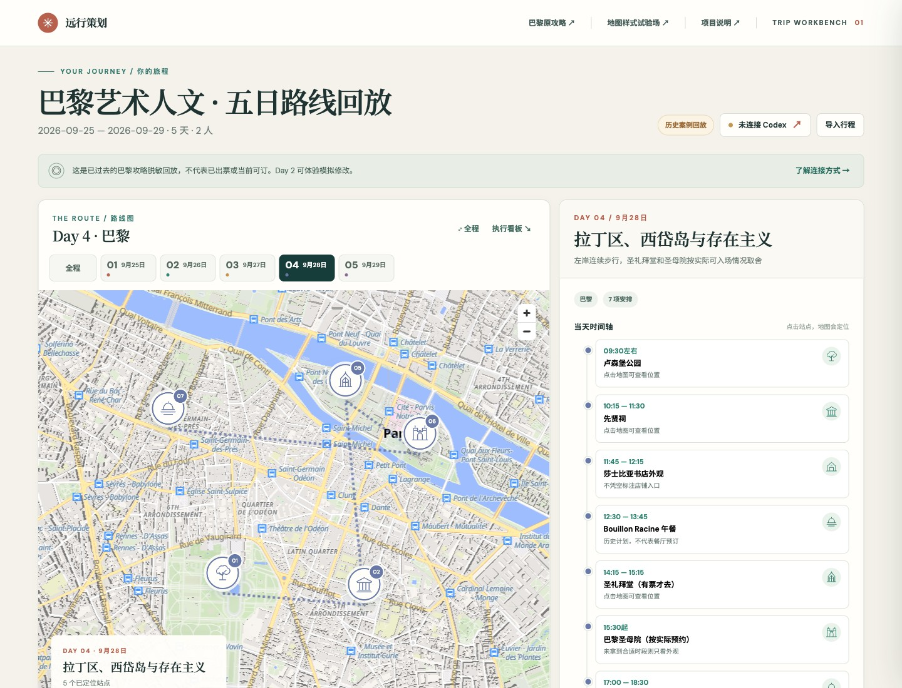
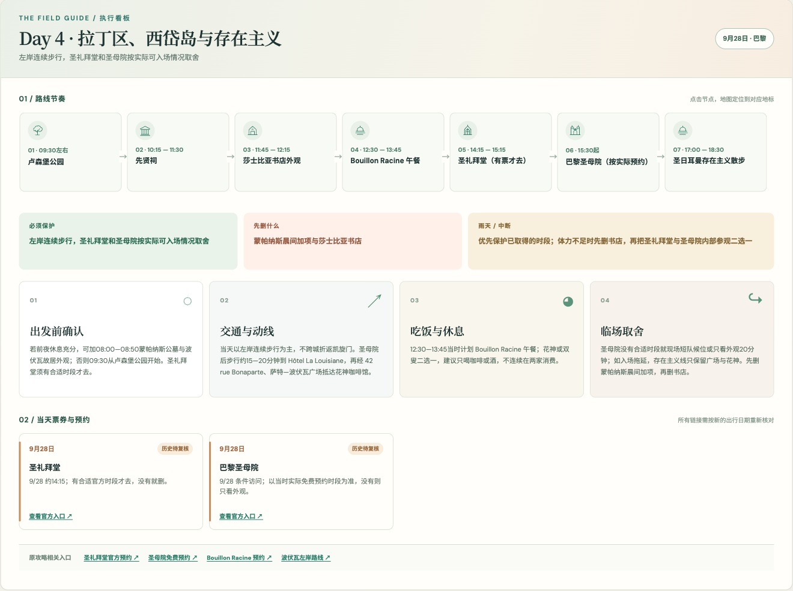
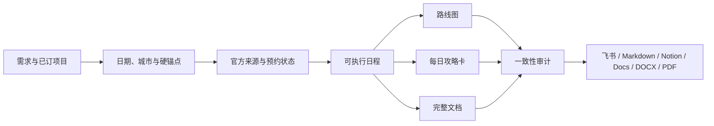

<p align="center">
  <a href="assets/readme-hero.svg">
    
  </a>
</p>

<h1 align="center">远行策划 · Plan & Maintain Trips</h1>

<p align="center">
  <strong>简体中文</strong> · <a href="./README.en.md">English</a>
</p>

<p align="center">
  <strong>把一次旅行，从零散想法变成可以预约、执行、调整和复查的完整项目。</strong>
</p>

<p align="center">
  
  
  
  
  <a href="LICENSE"></a>
</p>

> 不是再生成一份“景点清单”。所有日程、预约、餐厅、路线图和当天执行卡，都由同一份行程状态派生；改动一个决定，其余产物会跟着同步。

## 先看真正能操作的工作台

> **跨平台使用说明：**这是一份遵循 [Agent Skills 开放格式](https://github.com/agentskills/agentskills/blob/main/docs/specification.mdx)的旅行规划 Skill，不限于 Codex。能安装 Skill 且可读写本地文件的代理，均可生成 `trip.json`，导入同一个工作台查看；本机自动提案桥接支持 Codex CLI，并新增 Claude Code CLI 适配器（协议与校验测试已通过，当前账号余额不足，未完成真实生成测试）。DeepSeek 等模型服务不是可安装 Skill 的代理，需通过支持它们的代理运行。

### 选你的入口

| 你使用的工具 | 安装 Skill | 与工作台的连接 |
| --- | --- | --- |
| Codex CLI / App | 下方 `npx skills` 或原有手动安装 | 导入/导出 JSON；Codex CLI 可选自动提案桥接 |
| [Claude Code](https://code.claude.com/docs/en/skills) | `npx skills` 选择 Claude Code | JSON 交接；CLI 可选自动提案桥接，需有效模型授权或余额 |
| [Kimi Code CLI](https://www.kimi.com/code/docs/en/kimi-code-cli/customization/skills.html)、[Gemini CLI](https://geminicli.com/docs/cli/skills/)、[OpenCode](https://opencode.ai/docs/skills/)、[Cursor](https://cursor.com/docs/skills)、[Qwen Code](https://qwenlm.github.io/qwen-code-docs/en/users/features/skills/)、[GitHub Copilot CLI](https://docs.github.com/en/copilot/how-tos/copilot-cli/customize-copilot/add-skills) | 用 `npx skills` 选择对应代理；按该代理的方式调用 Skill | 同机可连接共享文件工作台，代理保存后自动刷新；跨设备用 JSON 交接 |
| [WorkBuddy / CodeBuddy](https://cloud.tencent.cn/document/product/1831/137452) | 使用产品的本地 Skill 导入能力，具体位置以所用版本为准 | 能编辑同机文件时可用共享文件工作台；否则用 JSON 交接，未验证模型直连 |
| DeepSeek、Kimi 等模型 API / 网页聊天 | 模型本身不能安装本地 Skill；选一个支持 Skill 的代理运行 | 由代理生成 JSON；网页聊天若无文件与脚本能力不能完成完整工作流 |

安装器使用 [Vercel `skills` CLI](https://github.com/vercel-labs/skills/blob/main/README.md)，需要 Node.js 22.20+。在自己的旅程项目目录运行（安装器会让你选择代理；`-g` 可改为用户级安装）：

```bash
npx skills add judefluen-coder/plan-and-maintain-trips --skill plan-and-maintain-trips
```

本仓库根目录就是 Skill，因此 `npx skills` 可能复制整仓库。需要本地 ZIP 导入（如 WorkBuddy/CodeBuddy）时，可下载 [v0.3.0 精简 Skill ZIP](https://github.com/judefluen-coder/plan-and-maintain-trips/releases/download/v0.3.0/plan-and-maintain-trips-skill.zip)；也可克隆仓库后运行 `python3 scripts/package_skill.py /仓库外/plan-and-maintain-trips.zip` 自行打包。安装后在代理对话里说“使用 plan-and-maintain-trips Skill，为我生成旅程 `trip.json`”，让代理在 Skill 目录外保存文件。具体调用语法随代理变化，例如 Codex 用 `$plan-and-maintain-trips`，Kimi Code CLI 用 `/skill:plan-and-maintain-trips`；不要把这些写法互换。

**同一台电脑上，推荐共享文件工作台：**在安装目录或仓库根目录运行 `python3 bridge/server.py --provider manual --trip /你的绝对路径/trip.json`，打开它给出的专属链接并连接。选一天、写下调整要求、点“复制要求给 AI 代理”，把文字发给已安装 Skill 的代理；代理修改同一份 `trip.json` 后，工作台会自动刷新地图与日程。这种模式不从网页调用模型，也不要求代理提供可编程 CLI。请让代理写完后运行校验；工作台只自动展示校验通过的文件。

**不同设备或不能共享文件时，使用 JSON 交接：**打开[工作台](https://judefluen-coder.github.io/plan-and-maintain-trips/workbench/)导入 `trip.json`。调整时依次点“① 下载交接 JSON”“② 复制要求给 AI 代理”，完成后重新导入。此路径不会自动同步或备份旧文件。

这些跨代理路径使用你所选代理自己的模型、授权和费用；GitHub Pages 不提供算力，也不保存行程。共享文件模式会读本机文件，但不会替你批准代理改动；保留上一版并核对硬预约。Codex CLI 与 Claude Code CLI 桥接可由网页发起本机模型调用；其他代理尚无已验证的一键模型直连。

[打开远行策划工作台](https://judefluen-coder.github.io/plan-and-maintain-trips/workbench/)即可体验，无需安装。默认进入[巴黎五日历史案例](examples/france-2026/README.md)：在总图点 Day，下钻到当天地图和时间轴；订票、交通、餐食与临场取舍会在下方执行看板同步切换。Day 2 还可以体验**仅在浏览器内生效**的模拟修改提案。

<p align="center">
  <a href="assets/workbench-overview-v2.jpg"></a>
</p>

<details>
<summary>展开看 Day 4：景点地图、时间轴和完整执行看板</summary>

<p align="center"><a href="assets/workbench-day-map-v2.jpg"></a></p>
<p align="center"><a href="assets/workbench-day-board-v2.jpg"></a></p>
</details>

<p align="center"><sub>以上均为实际工作台截图，不是概念稿。巴黎内容是已过去的 2026 年脱敏攻略；地图点不是入口导航，票务状态不代表今天可订。</sub></p>

## 除工作台之外，还能交付什么

### 1. 一张看懂多天路线

每天一种颜色，站点按顺序编号；步行、公共交通、强度、固定预约和 first cut 都在图上，不需要再对着长篇文字找重点。

可查看[巴黎高清路线图](examples/france-2026/paris-route-4k.png)或[可编辑的路线图排版示意 SVG](assets/readme-route-sample.svg)。前者是历史攻略成品，后者是视觉示意，不是同一份数据。

### 2. 每天一张真正能带走的攻略图

长攻略适合出发前研究，旅行当天更需要一眼就能执行的卡片。每张卡只保留当日必要信息：必须保护的预约、抵达时间、顺序、票夹、路线、午餐、强度，以及迟到或下雨时怎么删。

[查看从示例 `trip.json` 实际生成的 Day 02 卡片（PNG）](examples/lisbon-coast/day-02.png)、[无损 SVG](examples/lisbon-coast/day-02.svg)和[对应文字版](examples/lisbon-coast/field-cards.md)，可以核对哪些信息确实来自数据。示例数据为英文虚构行程；另有[中文排版示意](assets/readme-day-card.svg)。

这样的执行卡可以：

- 每天单独输出为高清 PNG，直接保存到手机相册；
- 保留 SVG 无损源文件，适合修改、打印或插入攻略文档；
- 同时保留文字版，便于搜索、复制地址和使用无障碍工具；
- 在酒店、航班或票号尚未确认时留下显眼的待补字段，不编造信息。

### 3. 一份计划，多种文档出口

飞书不是前置条件，而是可选发布端。Skill 会先把本地交付包做完整，再根据当前已连接的工具输出到用户真正使用的平台。

[查看多文档发布结构图](assets/readme-publishing.svg)。

支持的输出方式：

- **始终可用：** Markdown、`trip.json`、路线图 SVG/PNG、每日执行卡；
- **飞书 / Lark：** 已安装并授权相应能力时，可写入 Docx 或 Wiki，插入图片并在发布后读回校验；
- **Notion / Google Docs：** 相应连接器可用并获得授权时发布；
- **DOCX / PDF：** 文档工具可用时生成可编辑版或打印归档版；
- **平台不可用时：** 核心攻略仍然完整交付，不会因为没有 CLI、账号或连接器而停住。

## 从示例走到自己的旅程

1. **先体验：**打开[巴黎工作台](https://judefluen-coder.github.io/plan-and-maintain-trips/workbench/)，点击 Day 标签或地图圆章，下钻后在「执行看板」查看完整信息。旧的[里斯本虚构示例](https://judefluen-coder.github.io/plan-and-maintain-trips/workbench/?demo=lisbon)仍可切换。
2. **创建自己的计划：**安装 Skill 后，在你使用的代理对话中描述日期、目的地、偏好和已有预约，让它在 Skill 目录**之外**生成自己的 `trip.json`。网页目前不提供从零生成整段旅程的托管式 AI。
3. **连接可视化工作台：**所有代理都可以直接导入 JSON。若使用 Codex CLI 或 Claude Code CLI 且需要网页内自动提案，确认本机 CLI 已安装并拥有可用的模型配额，再运行下方命令。桥接会打印并打开带临时配对凭据的线上工作台链接；在页面点「连接本机」完成连接。不要分享配对链接。浏览器若询问是否允许连接本机服务，只对你信任的页面授权。

   ```bash
   python3 bridge/server.py --trip /你的绝对路径/trip.json
   ```

   Claude Code 用户改用 `python3 bridge/server.py --provider claude --trip /你的绝对路径/trip.json`。Claude 桥接将 Skill 指导随请求发送，并禁用内置与 MCP 工具；本机 CLI 的授权或余额仍由用户自己承担。

4. **检查后再修改：**选一天，用自然语言提出调整；先看地图、时间轴和差异预览，确认后才写回本地 `trip.json`，并留 `.bak` 备份。目前一次只调整一天。模型请求使用你所选 CLI 和自己的配额；GitHub Pages 不提供模型算力，也不保存你的行程。详见[工作台使用与安全说明](web/README.md)。

想研究完整旅行攻略而非网页演示，可阅读[巴黎＋蔚蓝海岸案例](examples/france-2026/README.md)，其中有高清路线图、订票清单、交通、餐厅与酒店选址。想离线重跑脚本与导出文件，则用[虚构的 Lisbon → Cascais 数据](examples/lisbon-coast/README.md)和[在线离线路线页](https://judefluen-coder.github.io/plan-and-maintain-trips/)；两种案例用途不同。

版本变化见 [Changelog](CHANGELOG.md)。

发现问题或希望改进？请看 [贡献指南](CONTRIBUTING.md)，并用仓库的 Issue 模板提交脱敏复现信息。

第一次试用可按[五分钟新用户测试](docs/try-it.md)走一遍；维护者的[发布素材](docs/launch-kit.md)已备好，但尚未代替用户对外发帖。

## 完整能力与交付一览

上面的真实工作台截图展示了地图与执行看板；这张表说明整个项目在旅行规划过程中还会做什么。

| 规划环节 | 它会做什么 | 你会拿到什么 |
|---|---|---|
| 信息收口 | 整理日期、住宿、交通、预算、偏好、排除项与不可移动安排 | 行程总览 + 唯一事实源 `trip.json` |
| 官方查证 | 核对开放时间、闭馆日、预约规则、开票窗口与官方入口 | 带状态、证据、下一步和备选方案的订票 Checklist |
| 路线排程 | 综合地理位置、游玩时长、安检排队、移动时间、休息与体力 | 可执行到具体时间的每日详细路线 |
| 餐厅衔接 | 按当天路线、预约间隙、营业时间和排队风险选择餐厅 | 主选与备选餐厅 + 为什么适合当天的说明 |
| 地图与现场执行 | 用不同颜色和编号表达多日路线，并提炼当天必须保护的事项 | 高清路线图 + 每日执行攻略卡 |
| 离线与提醒 | 从带坐标和时间的行程生成手机路线页、地图点位和日历事件 | 单文件离线 HTML + KML + ICS |
| 现场重排与美食 | 迟到、闭馆或下雨时提出调整建议；按当天路线筛选已研究的餐厅 | 不改动原计划的重排建议 + 沿线餐厅候选 |
| 持续调整 | 每次改日期、酒店或景点时，检查受影响的预约、路线、餐厅与地图 | 变更记录 + 同步更新后的全套产物 |
| 最终交付 | 审计日期、晚数、硬锚点、链接、预算和版本一致性，再按需发布 | Markdown / 飞书 / Notion / Google Docs / DOCX / PDF |

## 为什么选远行策划

旅行计划最难的不是列出景点，而是订票、路线和临时变动之后，整份攻略仍然能用。这个 Skill 着重解决以下问题：

🧭 **一个事实源**　日期、住宿、交通、预约和排除项都保存在同一份规范状态里。

🎫 **预约状态不含糊**　明确区分“尚未开票”“日期未上线”“已售罄”“现场进入”和“已经订好”。

📍 **路线不只看距离**　同时考虑开门时间、安检、排队、坡度、行李、吃饭、休息和下一场预约。

🔁 **每次修改都有影响分析**　同步检查相关日期、门票、酒店、交通、餐厅、地图、预算和每日卡片。

🌧️ **每天都有现场决策**　明确写出必须保护什么、迟到先删什么、下雨或闭馆去哪里。

📦 **交付不绑平台**　先生成可保存、可离线查看的本地文件；有相应授权时，再发布到飞书等文档平台。

## 工作方式



## 30 秒开始使用

公开仓库无需 GitHub 登录。用 Git 和 Python 3.11+ 安装，然后运行完全离线的示例：

```bash
git clone https://github.com/judefluen-coder/plan-and-maintain-trips.git "$HOME/.codex/skills/plan-and-maintain-trips"
cd "$HOME/.codex/skills/plan-and-maintain-trips"
python3 scripts/demo.py
```

命令会校验[同一份虚构行程数据](assets/trip.example.json)，在临时目录生成路线图 SVG、每日执行卡 SVG＋文字版、可离线打开的路线页、KML、ICS、延误＋雨天重排建议和沿线餐厅候选，并打印实际文件路径；不联网、不购买或预约。它**不自动生成**真实世界资料核验、完整文字攻略或飞书文档；这些需要在 Codex 中使用 Skill，并按目的地核实来源。

新建 Codex 任务或重新加载 Skill 后，可以这样开始：

```text
使用 $plan-and-maintain-trips，帮我规划 10 月 1 日到 10 月 10 日的日本旅行。
东京入境、大阪离境，两个人，强度适中。
请给我订票 Checklist、详细路线、路线关联餐厅、每日攻略图和最终文档。
```

它也适合持续修改已有计划：

```text
使用 $plan-and-maintain-trips 更新现有行程：京都酒店不变，已订的新干线不能移动；
把奈良往后挪一天，并同步修改餐厅、预约 Checklist、路线图和每日执行卡。
```

<details>
<summary><strong>预约状态词典</strong></summary>

- `bookable`：目标日期现在可以预订。
- `not_released`：官方明确尚未开始销售。
- `date_not_in_system`：日期尚未进入系统，暂无充分证据判断开售规则。
- `sold_out`：官方明确显示目标日期或场次售罄。
- `walk_in`：正常现场进入，无需提前预约。
- `same_day`：只能或适合当天预约。
- `booked`：用户已有确认号、票据或二维码。
- `needs_recheck`：当前结论临时有效，已经设置复查时间。

`unknown` 只允许在研究过程中短暂存在，最终交付前必须消除。

</details>

<details>
<summary><strong>内置校验与路线图工具</strong></summary>

这些脚本只使用 Python 标准库：

```bash
# 检查日期、住宿晚数、硬锚点、预约证据和未解决占位符
python3 scripts/validate_trip.py trip.json --strict

# 从同一份 trip.json 生成 2480×3508 的无损 SVG 路线图
python3 scripts/render_route_map.py trip.json route-map.svg --from-trip

# 检查攻略里的购票与预约链接
python3 scripts/check_links.py guide.md

# 从同一份 trip.json 导出离线路线页、地图点位和日历
python3 scripts/export_field_pack.py trip.json output/

# 从同一份状态导出每天的 SVG 执行卡和文字版
python3 scripts/render_field_cards.py trip.json output/

# 根据迟到、闭馆或下雨生成当天调整建议（不会改写 trip.json）
python3 scripts/replan_day.py trip.json --date 2030-05-02 --delay-minutes 45 --rain

# 从已核验的餐厅候选中找当天午餐
python3 scripts/suggest_food.py trip.json --date 2030-05-01 --meal lunch

# 也可以加载可跨行程复用的城市餐厅库
python3 scripts/suggest_food.py trip.json --date 2030-05-01 --meal lunch --catalog city-restaurants.json
```

成功的状态校验示例：

```text
PASS: 5 days, 2 segments, 2 anchors, 2 bookings; 0 errors, 0 warnings
```

</details>

<details>
<summary><strong>仓库结构</strong></summary>

```text
plan-and-maintain-trips/
├── README.md / README.en.md
├── LICENSE
├── CHANGELOG.md
├── SKILL.md
├── .github/workflows/        # CI 与示例预览发布
├── agents/openai.yaml
├── examples/lisbon-coast/    # 可打开的完整示例输出
├── examples/france-2026/     # 脱敏历史案例；非可重跑数据集
├── assets/
│   ├── trip.example.json
│   ├── route.example.json
│   ├── restaurants.example.json
│   ├── guide-template.md
│   ├── readme-*.{png,svg}       # 中文视觉稿
│   ├── readme-*.en.{png,svg}    # English visuals
│   └── workbench-*.jpg         # 真实工作台截图
├── web/                         # GitHub Pages 交互工作台
├── bridge/                      # 可选本机 Codex / Claude 桥接
├── references/
│   ├── state-model.md
│   ├── research-and-evidence.md
│   ├── scheduling-and-change-control.md
│   ├── deliverables-and-publishing.md
│   └── quality-gates.md
├── scripts/
    ├── validate_trip.py
    ├── render_route_map.py
    ├── render_field_cards.py
    ├── export_field_pack.py
    ├── replan_day.py
    ├── suggest_food.py
    ├── demo.py
    └── check_links.py
└── tests/                    # 行为测试
```

</details>

## 设计边界

- 不会未经授权替用户购买、预约、发消息、安装软件或发布文档。
- 不会把未出现目标日期直接写成售罄，也不会静默移动用户指定的硬锚点。
- 不会把聚合平台的诱导价与含税、同房型、同退改条件的最终价格混为一谈。
- 路线图用于规划；出发当天仍应检查实时导航、天气和运营方通知。
- 离线 HTML 可查看行程和示意路线；点击导航需要网络。KML 连线只表达游览顺序，餐厅距离是直线距离。
- 不在项目或 Skill 中保存护照、支付信息、账号凭证、Token 或授权码。

---

<p align="center">
  <strong>漂亮地规划，克制地预约，从容地出发。</strong><br>
  <sub>Plan beautifully. Book deliberately. Travel calmly.</sub>
</p>
