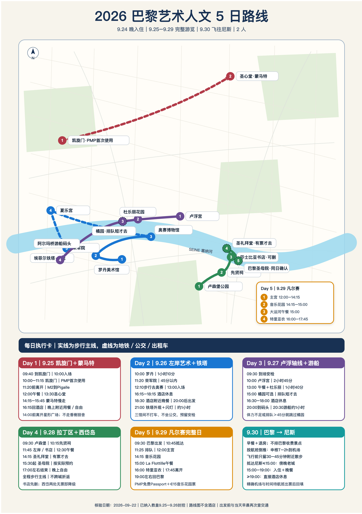
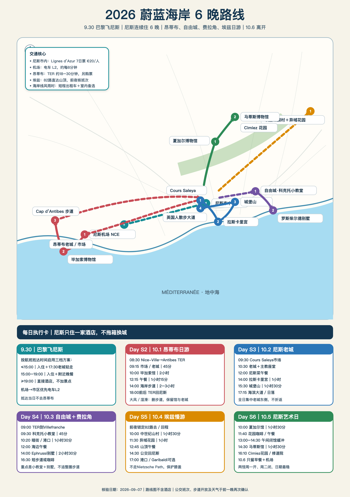

# 法国艺术人文攻略｜巴黎＋蔚蓝海岸（2026 历史案例）

旅行日期：2026年9月24日—10月6日｜2人｜巴黎6晚＋尼斯6晚

路线与当时的教皇访问影响核验：2026年9月23日
这是一次真实规划方法的脱敏展示，不是当下可直接下单的行程；不公开旅客身份、订单、报价或票券。景点开放时间、交通班次、价格、库存和临时管制请按你的出发日期重新核对。下文“现在要做什么”是**当时出发前的动作**，不代表今天仍可预约。

## 这次更新最重要的变化

教皇9月25—26日在巴黎。官方管制覆盖拉丁区、圣母院、联合国教科文组织、协和广场、香榭丽舍和七区多条道路，因此原来的9月25日拉丁区路线不再可靠。

- **9月25日改成凯旋门＋蒙马特**：10:00先去凯旋门，11:20前离开星形广场，再搭地铁2号线去Pigalle；晚上不设硬预约。
- **9月26日保留罗丹—荣军院—奥赛**，三馆之间全部步行，不用出租车和公交穿越七区；20:00后再去铁塔。
- **9月28日只走左岸连续路线**：卢森堡公园—先贤祠—西岱岛—圣日耳曼存在主义散步，不再跨城折返凯旋门；蒙帕纳斯公墓只作早晨可选项。
- 卢浮宫仍为9月27日，凡尔赛仍为9月29日，奥赛仍为9月26日13:00。

[巴黎市政府管制总览](https://www.paris.fr/pages/les-perturbations-a-paris-31469)｜[八区封站与封路](https://mairie08.paris.fr/pages/visite-du-pape-a-paris-toutes-les-informations-pratiques-dans-le-8e-arrondissement-36207)｜[教皇官方行程](https://dioceseparis.fr/venue-du-pape-leon-xiv-le.html)

## 订票 Checklist｜当时的计划与官方入口

所有项目以确认邮件或二维码为准；“买了PMP”不等于已经拿到卢浮宫、凡尔赛或圣礼拜堂时段。

| 项目 | 日期/时间 | 当时要做什么 | 官方入口 |
|---|---|---|---|
| 巴黎博物馆通票6日 | 9/25首次使用 | 2人各一张；在凯旋门首次刷票，覆盖到9/29凡尔赛 | [PMP官网](https://www.parismuseumpass.fr/en/pass) |
| 奥赛 | 9/26 13:00 | 确认票面时间与入口 | [奥赛官网](https://www.musee-orsay.fr/en/visit) |
| 卢浮宫 | 9/27，按票面 | 日期不动；只有二维码才算完成 | [官方预约](https://ticket.louvre.fr/en/billetterie/4505) |
| 塞纳河游船 | 9/27晚 | 查当天班次和天气；20:00到码头 | [班次与码头](https://www.bateaux-mouches.fr/en/cruise/information) |
| 圣礼拜堂 | 9/28约14:15 | 有合适官方时段才去，没有就删 | [官方预约](https://tickets.monuments-nationaux.fr/en-GB/families?site=2035141861660400306) |
| 巴黎圣母院 | 9/28约15:30 | 当天08:00、12:00、15:00尝试免费预约；以实际时段为准 | [免费预约](https://resa.notredamedeparis.fr/en/reservationindividuelle/tickets) |
| 凡尔赛 | 9/29 12:00 | 确认PMP Passport时段和音乐花园票 | [官方票务](https://ticket.chateauversailles.fr/en?step=tickets&date=2026-09-29) |
| 9/30航班 | 巴黎→尼斯 | 把机场、起飞和落地时间存入两部手机 | 航司订单 |

## 一页总览

| 日期 | 主线 | 硬锚/风险 | 强度 |
|---|---|---|---:|
| 9/24 | 抵达巴黎 | 只入住 | 低 |
| 9/25 | 凯旋门＋蒙马特 | 10:00先去凯旋门；14:00前离开星形广场 | 中 |
| 9/26 | 罗丹＋荣军院＋奥赛＋铁塔 | 13:00奥赛；七区封路 | 中高 |
| 9/27 | 卢浮宫＋塞纳河游船 | 卢浮按票面；橘园只作可选项 | 中 |
| 9/28 | 拉丁区＋西岱岛＋圣日耳曼 | 圣礼拜堂/圣母院条件访问；存在主义散步无需预约 | 中高（不加公墓则中） |
| 9/29 | 凡尔赛 | 主宫12:00 | 较高 |
| 9/30 | 巴黎飞尼斯 | 不加巴黎收费景点 | 低 |
| 10/1 | 昂蒂布 | 海岸步道看风浪 | 中高 |
| 10/2 | 尼斯老城 | 无硬预约 | 中 |
| 10/3 | 自由城＋费拉角 | 港口午餐建议预约 | 中 |
| 10/4 | 埃兹 | 前夜确认82路 | 中 |
| 10/5 | 夏加尔＋马蒂斯 | 两馆均周一开放 | 中 |
| 10/6 | 离开尼斯 | 只留早餐/短走 | 低 |

## 巴黎｜每天照着走

### 9月24日 周四｜抵达

入住、酒店附近简餐、补水和睡眠。不要去圣母院或“顺便看夜景”。两部手机都保存酒店法文地址、9月25日封控提示、PMP凭证和离线地图。

### 9月25日 周五｜凯旋门＋蒙马特

**时间线：**09:40到凯旋门地下通道/安检口 → 10:00—11:15凯旋门（PMP首次使用）→ 11:20前离开星形广场，乘地铁2号线去Blanche/Pigalle → 12:00—13:15午餐 → 13:30—14:15圣心堂 → 14:15—15:45蒙马特慢走 → 16:15左右回酒店 → 18:30酒店附近晚餐，晚上自由。

**交通规则：**今天不进入卢森堡、Saint-Michel、圣母院、联合国教科文组织、协和广场或香街核心区。官方公告显示星形广场及香街周边14:00起加强管制，Charles de Gaulle–Étoile等站计划22:00起关闭；因此凯旋门只放在上午，结束后直接从M2离开，不沿香榭丽舍散步。当天早晨仍要复核Bonjour RATP/巴黎市公告。

**先删什么：**蒙马特小巷延伸。若凯旋门当天临时改变入口，只看外观和无名烈士墓后返回，不在周边滞留。

### 9月26日 周六｜左岸艺术＋铁塔夜景

**时间线：**10:00—10:55罗丹 → 11:05—11:45荣军院穹顶/拿破仑墓 → 11:45外带午餐 → 12:10步行去奥赛并接受安检 → 12:40到场 → 13:00—16:00奥赛 → 16:15回酒店休息 → 18:30酒店附近晚餐 → 20:00后出发去Trocadéro → 21:00看铁塔闪灯。

**交通规则：**七区8:00—20:00大范围禁止机动车，三馆之间不打车、不坐公交。Varenne、Ségur、École Militaire等站按当天公告判断；回酒店优先从Solférino乘地铁12号线。Charles de Gaulle–Étoile、George V、Franklin D. Roosevelt、Champs-Élysées–Clémenceau、Alma-Marceau、Concorde关闭至20:00。

**先删什么：**罗丹花园延伸、铁塔第一轮闪灯之后的停留。13:00奥赛不能迟到。

### 9月27日 周日｜卢浮宫＋塞纳河游船

**时间线：**按卢浮票面提前30分钟安检 → 参观约2小时45分 → 13:00快速午餐 → 从卢浮一侧进入杜乐丽 → 15:00若体力足且排队不超过30—45分钟再进橘园 → 16:30—18:00酒店休息 → 18:15 Chez Francis → 20:00到Port de la Conférence → 乘最接近20:30的船。

协和广场仍可能有设施和绕行，杜乐丽从卢浮端进入，橘园也从花园内部接近。橘园是完全可选项，排队超过45分钟、卢浮离馆变晚或体力不足都直接取消。

### 9月28日 周一｜拉丁区＋西岱岛＋圣日耳曼

**主线：**09:30卢森堡公园 → 10:15—11:30先贤祠 → 11:45—12:15左岸/莎士比亚书店 → 12:30—13:45 Bouillon Racine → 14:15—15:15圣礼拜堂（有票才去）→ 15:30起巴黎圣母院（按实际免费预约时段）→ 17:00左右离开西岱岛。

**17:00—18:30存在主义散步（推荐，无需预约）：**从圣母院步行约15—20分钟到Hôtel La Louisiane（60 rue de Seine，只看外观）→ 42 rue Bonaparte萨特故居纪念牌 → 萨特—波伏瓦广场 → 花神咖啡馆或双叟咖啡馆二选一。历史关联以花神更集中，建议只点咖啡或酒，不在两家连续消费。全段约1.5公里；如果圣母院实际入场延迟，就省略酒店和故居外观，只保留广场＋花神。

**08:00可选加项｜蒙帕纳斯纪念线：**08:00—08:35蒙帕纳斯公墓第20区萨特与波伏瓦合葬墓 → 08:40—08:50 11 bis rue Victor-Schœlcher波伏瓦故居外观 → 步行到卢森堡公园，09:30接回主线。仅在前一晚休息充分时加入；它会让当天强度由“中”升为“中高”。

今天以步行为主，不再跨城去凯旋门。圣礼拜堂没票就不排司法宫；圣母院未拿到合适时段则现场短队候位或只看外观20分钟。体力不足首先取消蒙帕纳斯晨间加项，其次删书店；圣礼拜堂与圣母院内部参观仍可二选一。

[巴黎市波伏瓦左岸路线](https://www.paris.fr/pages/sur-les-pas-de-simone-de-beauvoir-ecrivaine-et-feministe-emblematique-de-paris-21516)｜[蒙帕纳斯公墓开放时间](https://www.paris.fr/lieux/cimetiere-du-montparnasse-4082)｜[花神咖啡馆历史](https://cafedeflore.fr/dans-les-coulisses-dun-cafe-culte/)｜[Hôtel La Louisiane历史](https://hotel-lalouisiane.com/histoire)

### 9月29日 周二｜凡尔赛

09:30巴黎出发 → 10:45抵达/轻食 → 11:25排队 → 12:00—14:15主宫 → 14:15—15:00音乐花园 → 15:00 La Flottille午餐 → 16:00—17:45特里亚农 → 19:00左右回巴黎。前夜复核RER C、天气与票面；下雨或疲劳时主宫不删，花园压至30分钟，特里亚农只留一处。

### 9月30日 周三｜巴黎飞尼斯

巴黎只安排早餐、退房和机场交通；最多在酒店500米内散步30分钟。抵达尼斯15:00前可傍晚轻走老城，15:00—19:00抵达只入住吃饭，19:00后抵达直接休息。

## 蔚蓝海岸｜尼斯作为唯一基地

9月30日至10月6日连续住尼斯，不换酒店。昂蒂布、自由城/费拉角和埃兹全部当天往返，避免搬行李。

### 10月1日 周四｜昂蒂布

08:30左右TER到Antibes → 09:15老城/市场 → 10:00—12:00毕加索博物馆 → 12:15午餐 → 短程出租车去Cap d’Antibes步道起点 → 14:00—17:00海岸步道 → TER回尼斯。大风、海浪或地面湿滑时取消整段步道。

[毕加索馆](https://www.antibes-juanlespins.com/sorties-loisirs/antibes-ville-de-culture/les-musees/le-musee-picasso/preparer-votre-visite)｜[SNCF查询](https://www.sncf-connect.com/en-en/train/route/nice/antibes)

### 10月2日 周五｜尼斯老城

09:30 Cours Saleya → 10:20老城和主教座堂 → 12:00尼斯菜午餐 → 14:00 Palais Lascaris → 15:30城堡山 → 17:15英国人散步大道。城堡山优先用免费电梯；累了删除海滨大道延伸。

### 10月3日 周六｜自由城＋费拉角

09:00左右TER到Villefranche-sur-Mer → 09:30科克托圣彼得小教堂 → 老城和港口 → 12:00 La Mère Germaine → 短程出租车到Villa Ephrussi → 14:00—16:30别墅与花园 → 返回尼斯。雨天删除花园后的海岸步道。

### 10月4日 周日｜埃兹

前夜锁定82路去回程 → 10:00山村 → 11:30异域花园 → 12:45午餐 → 14:30左右82路/出租车回尼斯。不要走Nietzsche Path下山；错过合适回程班次就叫车。

### 10月5日 周一｜夏加尔＋马蒂斯

10:00—11:30夏加尔国家博物馆 → 附近午餐 → 14:30—16:00马蒂斯博物馆 → Cimiez花园/修道院外观 → 告别晚餐。雨天删除室外部分，不跨城加项目。

### 10月6日 周二｜离开尼斯

只留早餐、海边30分钟以内短走和机场交通。夏加尔和马蒂斯周二闭馆，不安排收费景点。

## 餐厅｜只处理影响路线的几顿

| 日期 | 安排 | 动作 |
|---|---|---|
| 9/25 | Pigalle午餐＋酒店附近晚餐 | 不去Bouillon Racine和L’Alsace；已订则取消/改期 |
| 9/27 18:15 | Chez Francis | [官网预约](https://chezfrancis-paris.com/en/accueil-english/) |
| 9/28 12:30 | Bouillon Racine | 把原9/25计划改到今天；[官网预约](https://www.bouillonracine.fr/?lang=en&page_id=2495) |
| 9/29 15:00 | La Flottille | [官网](https://www.laflottille.fr/) |
| 10/3 12:00 | La Mère Germaine | [官网预约](https://www.meregermaine.fr/) |
| 10/4 12:45 | Le Nid d’Aigle或同村备选 | 散客不接受预约，现场候位；[尼斯旅游局信息](https://www.explorenicecotedazur.com/en/restaurant/le-nid-daigle/) |

## 酒店建议｜巴黎与尼斯各住一家

这份路线的住宿原则是**每城一个基地**：巴黎优先平衡卢浮宫、左岸和机场交通；尼斯优先兼顾火车站（昂蒂布、自由城日归）、老城与机场电车。下列是选址候选，不代表实际入住或当期报价。两人一张大床、每晚不超过人民币 2500 元是当时的筛选条件；比较时要看旅行日期的**含税六晚总价**、床型、取消条款和早餐，而不是只看首页“起价”。

| 城市 | 候选酒店 | 为什么适合这条路线 | 订前核对 |
|---|---|---|---|
| 巴黎 | [Novotel Paris Les Halles](https://all.accor.com/hotel/0785/index.en.shtml) | Châtelet–Les Halles 交通枢纽；卢浮宫、西岱岛和左岸线路较顺 | 核对房型、噪音与含税总价 |
| 巴黎 | [Hôtel de l’Université](https://www.universitehotel.com/) | 圣日耳曼左岸位置好，适合奥赛、罗丹、存在主义散步 | 小型酒店；核对电梯可达楼层、房间面积与行李需求 |
| 巴黎 | [Hyatt Regency Paris Étoile](https://www.hyatt.com/en-US/hotel/france/hyatt-regency-paris-etoile/parhr) | 若更重视凯旋门一侧和大型酒店配套，可作价格合适时的备选 | 到左岸多次需乘地铁；核对交通时间和总价 |
| 尼斯 | [ibis Styles Nice Centre Gare](https://all.accor.com/hotel/9907/index.en.shtml) | 靠近 Nice-Ville，昂蒂布与自由城的 TER 日归省心 | 核对去老城和海边的步行/电车时间 |
| 尼斯 | [AC Hotel Nice](https://www.marriott.com/en-us/hotels/nceac-ac-hotel-nice/overview/) | 更偏海滨度假，适合想在尼斯多留海边时间的人 | 到 Nice-Ville 的接驳较多；核对房型与总价 |

**本案取舍：**如果价格接近，巴黎先看 Les Halles 或圣日耳曼，尼斯先看 Nice-Ville 周边；不要为每天换酒店而牺牲半天行程。上述候选未做 2026 年 9—10 月实时价格核验。

## 交通、网络与当天检查

**巴黎。**9月25—26日不用出租车穿越当时封控区；每天早晨查看 [Île-de-France Mobilités](https://www.iledefrance-mobilites.fr/en/) 与 Bonjour RATP。市内跨区优先地铁/RER，步行20分钟以内且沿途好逛则步行；骑 [Vélib’](https://www.velib-metropole.fr/) 只限干燥天气、短距离平路，不用于蒙马特或石板路。去凡尔赛前夜复核 RER C 运营，再以票面入场时间倒推发车。

**巴黎→尼斯。**9月30日按已购航班走，不在巴黎安排收费景点；机场、航站楼、托运行李截止时间与尼斯落地后的电车/出租车接驳都从航司订单反推。案例不公开私人航班号。

**尼斯。**市区使用 [Lignes d’Azur](https://www.lignesdazur.com/)，昂蒂布和自由城用 [SNCF TER](https://www.ter.sncf.com/sud-provence-alpes-cote-d-azur)；埃兹82路前夜在运营商页面核对并截图去回程。去 Ephrussi 和 Cap d’Antibes 步道起点，两人短程出租车可作为省时备选；提前评估车费和上车点。

**网络与翻译。**两人最好各有一张欧洲数据卡/eSIM，国内SIM保留收验证码但关闭数据漫游；下载巴黎和蔚蓝海岸离线地图，以及Google翻译的中法离线语言包。所有门票、酒店地址和保险资料在两部手机离线保存。

**每天早晨只看四件事：**天气、交通/封控、当天二维码、第一段导航。迟到时按每天写明的“先删什么”执行，不临时压缩硬预约。

## 现场应急

- 欧盟通用急救：112；法国医疗15、警察17、消防18。
- 两人走散时以酒店或当天第一个硬预约入口为集合点，不只依赖电话。
- 证件、银行卡和手机分开放；地铁门口和热门景点不把手机放外套口袋。
- 医疗、过敏和法律沟通不要只用机器翻译，请对方找英语工作人员。

本版路线核验于2026年9月23日。9月25—26日封控属于高波动信息，必须在前一晚和当天早晨复核官方公告。9月28日存在主义散步无需购票或预约；公墓晨间加项前一晚复核开放时间即可。
